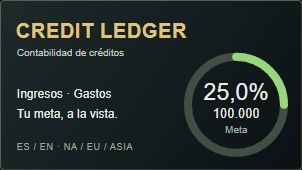
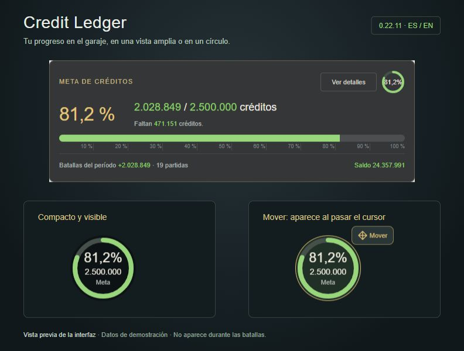
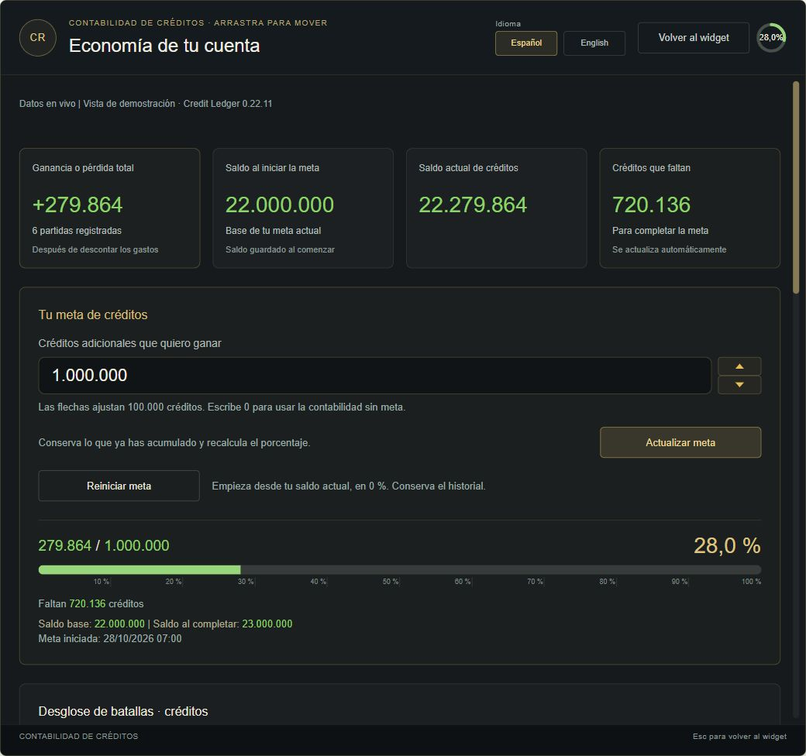
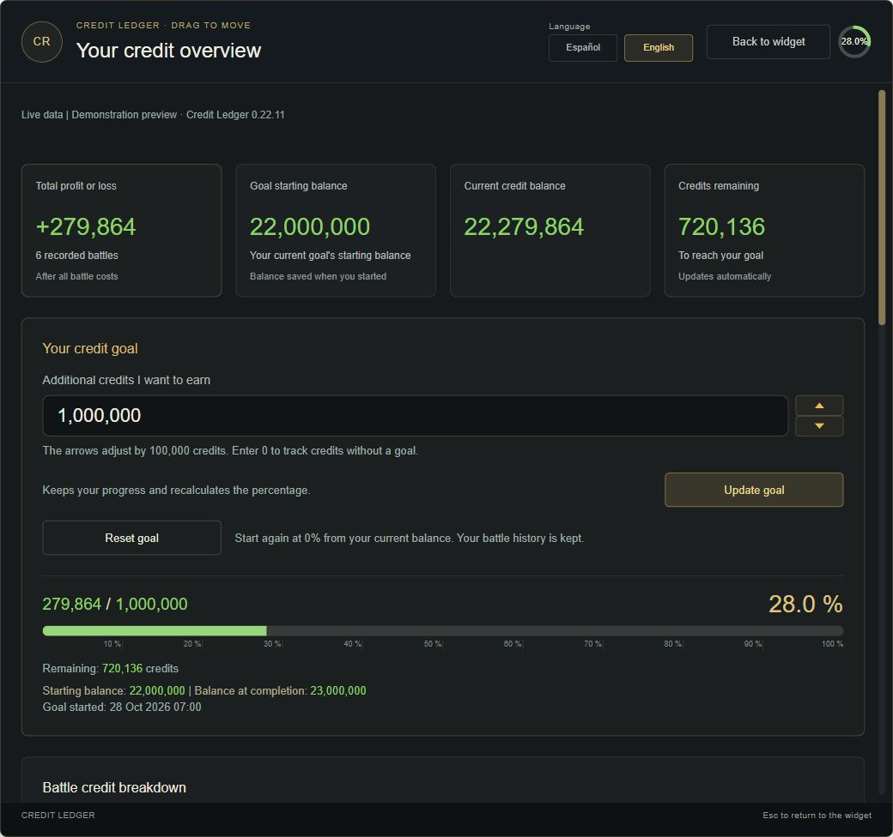
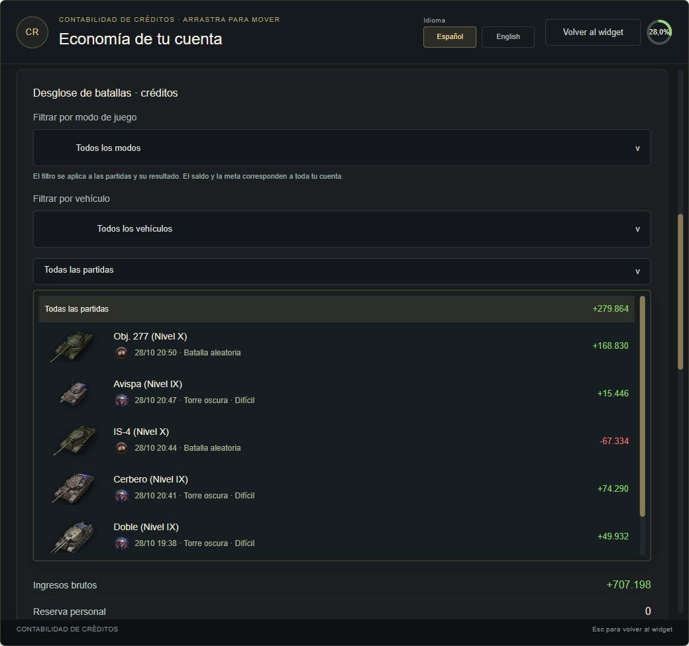
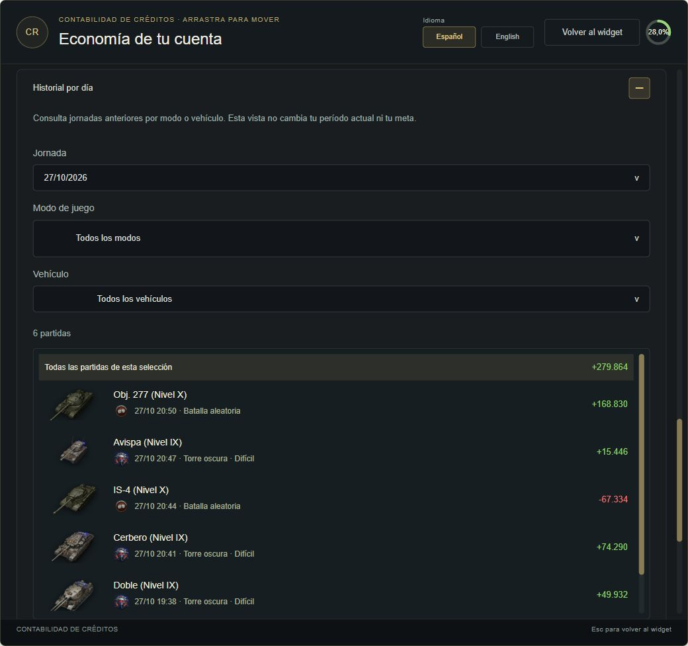

<p align="center">
  
</p>

# Credit Ledger / Contabilidad de créditos

Mod para **World of Tanks PC de Wargaming** que muestra cuánto ganas o pierdes en créditos, tus gastos y el progreso de una meta personal.

**Versión estable: 0.22.11 · Español / English**

[English guide](README-en.md) · [Guía de uso](LEEME.md) · [Compilar el proyecto](docs/BUILD.md) · [WGMods](https://wgmods.net/8056/)

## Así se ve



Elige entre el panel ampliado y el círculo de progreso. El control para moverlo aparece al pasar el cursor.

<details>
<summary><strong>Ver las capturas: detalles, filtros e historial</strong></summary>

### Detalles en español



### Detalles en inglés



### Desglose y filtros de batallas



### Historial por día



</details>

*Las mismas vistas de presentación de 0.22.11 publicadas en WGMods; los importes son datos de demostración.*

## Funciones

- Widget visible únicamente en el garaje, con un círculo de progreso que puedes mover y expandir.
- Meta inicial de 100.000 créditos adicionales para cuentas nuevas. Escribir 0 desactiva la meta; actualizarla conserva el avance.
- Desglose de ingresos, reparaciones, munición, consumibles y reservas personales y del clan, sin contar las bonificaciones dos veces.
- Historial filtrable por modo de juego y vehículo, con imagen y nivel nativos del tanque.
- Archivo por día, reinicio automático según el día del servidor y botón de reinicio manual.
- Español e inglés al instante, y una celebración breve al completar la meta.
- Instalador sencillo para Windows, incluido dentro del ZIP de distribución.

## Compatibilidad de esta versión

WoT **2.4.1.0 y 2.4.1.1**, regiones **NA, EU y ASIA**. La compatibilidad con otras versiones debe revisarse antes de instalar. Lesta/Mir Tankov, Blitz y el cliente de prueba común no están cubiertos.

Las pruebas conectadas anteriores de contabilidad de EU (+49.640) y ASIA (+64.197) se realizaron en **2.4.1.0**. En 2.4.1.1 el usuario confirmó las correcciones del garaje y el círculo; esto no equivale a una nueva prueba conectada en las tres regiones.

## Descargar e instalar

Descarga el ZIP de la versión desde [Releases](https://github.com/amayadiego22-cloud/credit-ledger/releases) o desde [la ficha de WGMods](https://wgmods.net/8056/) cuando esa versión esté disponible allí. La publicación en GitHub es independiente de la revisión de WGMods.

1. Cierra World of Tanks por completo.
2. Extrae el ZIP en una carpeta.
3. Ejecuta el instalador incluido y selecciona tu instalación de WoT. También puedes copiar la carpeta `mods` del ZIP en la carpeta principal del juego.
4. Abre el juego y entra al garaje.

El ZIP de GitHub **Code → Download ZIP** contiene el código fuente; el ZIP de **Releases** contiene el mod listo para instalar, con su instalador dentro.

## Organización del código

| Carpeta | Contenido |
| --- | --- |
| `capture/` | Eventos del cliente, resultados, saldo, metas, filtros e historial |
| `core/` | Cálculos y registro de contabilidad |
| `game/` | Punto de entrada que carga WoT |
| `ui/` | Interfaz HTML, CSS y JavaScript para Gameface |
| `resources/` | Manifiesto de la vista |
| `installer/` | Código C# del instalador y sus pruebas |
| `build_tools/` | Compilador local compatible con Python 2.7 |
| `tests/` | Pruebas con datos sintéticos |

El juego usa Python 2.7. Las herramientas de construcción y las pruebas se ejecutan con Python 3. No se incluyen archivos del cliente, DLL de Wargaming, imágenes nativas por separado, capturas de cuentas ni credenciales.

## Probar el código

Con Python 3 instalado, desde la raíz del proyecto:

```powershell
python -m unittest discover -s tests
python demo.py
```

La demostración utiliza datos ficticios y no se conecta al juego. Consulta [la guía de construcción](docs/BUILD.md) para generar un `.wotmod`, probar la interfaz y compilar el instalador.

## Datos locales

El mod guarda sus datos en la instalación del juego, bajo `mods/configs/credit_ledger`, separados por región y cuenta. Esos archivos no forman parte de este repositorio. No adjuntes tus capturas o registros completos a una incidencia sin revisarlos primero.

Proyecto de **ROLO / amayadiego22-cloud**. World of Tanks y sus recursos pertenecen a sus respectivos titulares.
